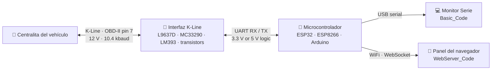

<a id="readme-top"></a>

<div align="center">

<a href="#-quick-start">
  
</a>

<h1>OBD2 Lector de K-Line</h1>

<p><b>Herramienta de diagnóstico automotriz de código abierto para ESP32, ESP8266 y Arduino.</b><br>
Consulta datos de sensores en directo; lee y borra códigos de avería (DTC), revisa los datos congelados y obtiene el VIN de vehículos con <b>K-Line</b><br>
mediante <b>ISO 9141-2</b> o <b>KWP2000 (ISO 14230)</b>, desde un panel web en el navegador del teléfono.</p>

<p>
  <a href="https://github.com/muki01/OBD2_K-line_Reader/stargazers"></a>
  <a href="https://github.com/muki01/OBD2_K-line_Reader/network/members"></a>
  <a href="https://github.com/muki01/OBD2_K-line_Reader/issues"></a>
  <a href="LICENSE"></a>
  <a href="https://github.com/muki01/OBD2_K-line_Reader/commits/main"></a>
</p>

<p>
  <a href="#default-pins"></a>
  <a href="#default-pins"></a>
  <a href="#default-pins"></a>
  <a href="#default-pins"></a>
  <a href="#default-pins"></a>
  <a href="#-supported-protocols"></a>
  <a href="#-supported-protocols"></a>
  <a href="https://pcbway.com/g/SD5aQu"></a>
</p>
**[Funciones](#-features)** · **[Demostración](#-see-it-in-action)** · **[Capturas](#-web-dashboard-screenshots)** · **[Cómo funciona](#-how-it-works)** · **[Hardware](#-hardware)** · **[Inicio rápido](#-quick-start)** · **[Preguntas frecuentes](#-faq)** · **[Desarrollo a medida](#-custom-development)**

</div>

---

## 📖 Acerca del proyecto

**OBD2 K-Line Reader** es un firmware completo, listo para cargar, que convierte un microcontrolador económico en una herramienta de diagnóstico OBD-II para vehículos con bus **K-Line**. Incluye muchos automóviles europeos y asiáticos fabricados aproximadamente entre **2000 y 2010**, antes de la generalización de CAN.

Conéctalo al puerto OBD-II para consultar **datos del motor en tiempo real**, **códigos de avería** (leer y borrar), **capturas congeladas**, **VIN e identificadores de calibración de la ECU**, un **cronómetro de aceleración de 0 a 100 km/h** y la **tensión de la batería**. No necesita adaptador ELM327, software de PC ni aplicación de pago.

El proyecto incluye dos versiones:

| Versión | Uso recomendado | Resultado | Placas |
|---|---|---|---|
| 🌐 **[`WebServer_Code`](WebServer_Code/README.md)** | Herramienta WiFi autónoma para exploración y diagnóstico | Panel web adaptable a móviles (WebSocket), actualizaciones OTA | ESP32 (incluidos S3 / C3 / C6), ESP8266 |
| 🖥️ **[`Basic_Code`](Basic_Code/README.md)** | Pruebas rápidas, aprendizaje y adaptación a otras placas | Monitor serie | Arduino Uno / Nano / Pro Mini, ESP32 |

También incluye **seis esquemas de interfaz**, desde un circuito con dos transistores hasta transceptores automotrices específicos (L9637D, MC33290, Si9241, SN65HVDA195), para construir el hardware por pocos euros.

> [!TIP]
> Si este proyecto te ahorra una visita al taller o te ayuda a aprender cómo se comunican los coches, puedes dejar una ⭐ al original para que otros creadores lo encuentren.

<a id="-see-it-in-action"></a>
## 🎬 Así funciona

<table>
<tr>
<td width="45%" align="center">

</td>
<td width="55%">

### Una herramienta de diagnóstico completa en tu bolsillo

El ESP32 crea su propia red WiFi. Conecta el teléfono, abre **`192.168.4.1`** y accede a las funciones de diagnóstico con un toque:

- 📊 **Datos en directo**: PID enviados en tiempo real mediante WebSocket.
- ⚠️ **Códigos de avería**: lee y borra DTC; incluye unas 1000 descripciones.
- ❄️ **Captura congelada**: valores de sensores guardados al registrarse la avería.
- 🏁 **Prueba de 0–100 km/h**: comienza y termina automáticamente a partir del PID de velocidad.
- 🚗 **Información del vehículo**: VIN, ID de calibración y mapas de PID admitidos.
- ⚙️ **Ajustes**: protocolo, selección de PID, WiFi y actualización OTA del firmware.
- 🌙 **Modo oscuro**, recordado en cada dispositivo.

No hace falta instalar una aplicación ni conectarse a la nube. Funciona en los navegadores de Android, iOS y ordenador.

</td>
</tr>
</table>

<a id="-features"></a>
## ✨ Funciones

<table>
<tr>
<td valign="top" width="33%">

#### 🩺 Diagnóstico
- Datos de sensores en directo (**Modo OBD-II 01**)
- Datos congelados (**Modo 02**)
- DTC almacenados (**Modo 03**)
- Borrar DTC / reiniciar el testigo MIL (**Modo 04**)
- DTC pendientes (**Modo 07**)
- VIN e identificadores de calibración (**Modo 09**)
- Unas 1000 descripciones de DTC (P, C, B, U)
- Supervisión de la tensión de batería

</td>
<td valign="top" width="33%">

#### 📡 Protocolos
- **ISO 9141-2** (inicialización a 5 baudios)
- **ISO 14230-4 KWP2000**, inicialización lenta
- **ISO 14230-4 KWP2000**, inicialización rápida
- **Detección automática del protocolo**
- Cambio de protocolo durante el funcionamiento
- Reconexión automática si se pierde el enlace
- Temporización correcta a 10,4 kbaudios, cancelación de eco y sumas de comprobación

</td>
<td valign="top" width="33%">

#### 🛠️ Plataformas
- ESP32 / S3 / C3 / C6, ESP8266
- Arduino Uno, Nano, Pro Mini
- Adaptable a STM32 y RP2040
- WiFi en modo **punto de acceso o estación**
- **Actualizaciones OTA del firmware** (ESP32)
- Ajustes guardados en SPIFFS
- Avisos de estado mediante zumbador y LED
- Seis opciones de interfaz de hardware

</td>
</tr>
</table>

<a id="-web-dashboard-screenshots"></a>
## 📱 Capturas del panel web

<div align="center">
<sub>Las capturas cambian entre tema claro y oscuro según el tema de GitHub.</sub>
</div>

<table>
<tr>
<td align="center" width="25%">
<picture><source media="(prefers-color-scheme: dark)" srcset="images/screenshots/dark/main-menu.png"></picture>
<br><b>Menú principal</b><br><sub>Tensión de batería y accesos rápidos</sub>
</td>
<td align="center" width="25%">
<picture><source media="(prefers-color-scheme: dark)" srcset="images/screenshots/dark/live-data.png"></picture>
<br><b>Datos en directo</b><br><sub>PID de sensores en tiempo real</sub>
</td>
<td align="center" width="25%">
<picture><source media="(prefers-color-scheme: dark)" srcset="images/screenshots/dark/error-codes.png"></picture>
<br><b>Códigos de avería</b><br><sub>Leer y borrar DTC</sub>
</td>
<td align="center" width="25%">
<picture><source media="(prefers-color-scheme: dark)" srcset="images/screenshots/dark/freeze-frame.png"></picture>
<br><b>Captura congelada</b><br><sub>Instantánea al producirse la avería</sub>
</td>
</tr>
<tr>
<td align="center">
<picture><source media="(prefers-color-scheme: dark)" srcset="images/screenshots/dark/speed-test.png"></picture>
<br><b>Prueba de 0–100 km/h</b><br><sub>Medición automática de aceleración</sub>
</td>
<td align="center">
<picture><source media="(prefers-color-scheme: dark)" srcset="images/screenshots/dark/vehicle-info.png"></picture>
<br><b>Información del vehículo</b><br><sub>VIN, ID de calibración y PID admitidos</sub>
</td>
<td align="center">
<picture><source media="(prefers-color-scheme: dark)" srcset="images/screenshots/dark/settings.png"></picture>
<br><b>Ajustes</b><br><sub>Protocolo, PID, WiFi y OTA</sub>
</td>
<td align="center">
<picture><source media="(prefers-color-scheme: dark)" srcset="images/screenshots/dark/splash-screen.png"></picture>
<br><b>Pantalla de inicio</b><br><sub>Animación de arranque</sub>
</td>
</tr>
</table>

> [!NOTE]
> La interfaz del panel se desarrolla en su propio repositorio: **[OBD2 Diagnostic UI](https://github.com/muki01/OBD2-Diagnostic-UI)**. Se incluye una copia compilada y comprimida con gzip en [`WebServer_Code/data`](WebServer_Code/data).

<a id="-how-it-works"></a>
## 🧭 Cómo funciona



1. **Activación.** El firmware despierta la ECU con una **inicialización de 5 baudios** (dirección `0x33`) o una **inicialización rápida** (pulso de 25 ms en bajo / 25 ms en alto seguido de `StartCommunication`: `C1 33 F1 81 66`).
2. **Detección.** En modo `Automatic` intenta ISO 9141-2, luego KWP2000 lento y rápido, y recuerda el protocolo con el que responde la ECU.
3. **Solicitud.** Las solicitudes de servicio OBD-II (Modos 01, 02, 03, 04, 07 y 09) se marcan con el encabezado adecuado (`68 6A F1` para ISO 9141 o `Cx 33 F1` para KWP2000) más un checksum.
4. **Decodificación.** Las respuestas se validan, se elimina el eco de la línea K y los valores se convierten a unidades de ingeniería usando las fórmulas SAE J1979.
5. **Publicación.** Los valores van al Monitor Serie, o al panel web como JSON sobre un WebSocket aproximadamente cada 100 ms.

<a id="-supported-protocols"></a>
### 📡 Protocolos compatibles

| Protocolo | Norma | Inicialización | Cabecera | Estado |
|---|---|---|---|:---:|
| ISO 9141-2 | ISO 9141-2 | Inicialización lenta a 5 baudios | `68 6A F1` | ✅ Probado |
| KWP2000 (inicialización lenta) | ISO 14230-4 | Inicialización lenta a 5 baudios | `Cx 33 F1` | ✅ Probado |
| KWP2000 (inicialización rápida) | ISO 14230-4 | Patrón de activación de 25 ms | `Cx 33 F1` | ✅ Probado |
| Detección automática | Ninguna | Prueba todas las opciones anteriores | Ninguna | ✅ Predeterminado |

> [!IMPORTANT]
> **¿Mi coche utiliza la línea K?** Mira el conector OBD-II. Si **el pin 7** tiene un contacto metálico, es muy probable que el coche utilice ISO 9141-2 o KWP2000. Los coches que solo tienen los pines 6 y 14 utilizan **CAN (ISO 15765-4)**; para esos, consulte **[OBD2 CAN Bus Reader](https://github.com/muki01/OBD2_CAN_Bus_Reader)**.

## 🔧 Hardware

### Qué necesitas

| Componente | Notas |
|---|---|
| Microcontrolador | ESP32 / ESP32-S3 / C3 / C6 o ESP8266 para el panel web; Arduino Uno / Nano / Pro Mini o ESP32 para `Basic_Code` |
| Interfaz K-Line | Cualquier circuito de los esquemáticos siguientes |
| Conector macho OBD-II | O un cable de extensión OBD-II cortado |
| Regulador de 12 V → 5 V / 3,3 V | Un pequeño convertidor reductor para alimentar la placa desde el pin 16 del OBD-II |
| *Opcional* | Zumbador y LED para indicar el estado; divisor de tensión de 47 kΩ / 10 kΩ para medir la batería |

### Conector OBD-II (Línea K)

| Pin OBD-II | Señal | Conectar a |
|:---:|---|---|
| **7** | Línea K (ISO 9141-2 / ISO 14230) | Pin K de la interfaz |
| **16** | +12 V de batería (permanente) | Entrada VBAT de la interfaz + regulador |
| **4** / **5** | Tierra del chasis / tierra de señal | GND común |

<a id="-interface-schematics"></a>
### 🔌 Esquemas de interfaz

La línea K es un bus de un solo hilo, de 12 V, colector abierto, por lo que no puede conectarse directamente a un UART de 3.3 V o 5 V. Cada circuito siguiente realiza el cambio de nivel y la protección. Elige uno.

#### Con transistores: económico y adecuado para prototipos


Construido con transistores discretos, por lo que casi no cuesta nada. **R6** está dimensionado para microcontroladores de **3.3 V**; para un **MCU de 5 V**, cambia **R6** a **5.3 kΩ**.
#### Con comparador LM393: mayor inmunidad al ruido


Un comparador barato como el **LM393** proporciona un nivel digital limpio con umbrales bien definidos. Necesita un par de componentes más que la versión con transistor, pero es claramente más robusto.

#### Transceptores automotrices específicos — L9637D, MC33290, Si9241, SN65HVDA195

<p>
  
  
</p>
<p>
  
  
</p>

Transceptores específicos para ISO 9141 con cambio de nivel integrado y protección. Son compatibles con estándares y la opción más fiable, lo que los convierte en la elección adecuada para diseños permanentes y de producción.

### 🧩 PCB personalizadas

<p align="center">
  
  
  
</p>

<table>
  <tr>
    <td width="20%" valign="middle">
      <a href="https://pcbway.com/g/SD5aQu"></a>
    </td>
    <td width="80%" valign="middle">
      Las PCB personalizadas en este proyecto se fabricaron con patrocinio de <a href="https://pcbway.com/g/SD5aQu"><b>PCBWay</b></a>. La calidad de las placas, la entrega rápida y el soporte fueron excelentes, y estoy agradecido por su ayuda. ¿Necesitas placas para tu propio proyecto? <a href="https://pcbway.com/g/SD5aQu"><b>Visita PCBWay →</b></a>
    </td>
  </tr>
</table>

<a id="-quick-start"></a>
## 🚀 Inicio rápido

```bash
git clone https://github.com/muki01/OBD2_K-line_Reader.git
```

1. **Construye la interfaz** utilizando uno de los [esquemáticos](#-interface-schematics) y conecta la interfaz al puerto UART de tu placa.
2. **Elige una compilación** y sigue su guía paso a paso:
   - 🌐 **[WebServer_Code: guía de configuración](WebServer_Code/README.md)** (panel web para ESP32 / ESP8266)
   - 🖥️ **[Basic_Code: guía de configuración](Basic_Code/README.md)** (monitor serie para Arduino / ESP32)
3. **Conéctate al puerto OBD-II**, enciende la ignición y espera unos segundos para la negociación.
4. **Compilación web:** conecta a la red WiFi **`OBD2 Master`** (contraseña `12345678`) y abre **http://192.168.4.1**.

<a id="default-pins"></a>
### Pines predeterminados

| Placa | Recepción K-Line | Transmisión K-Line | UART | LED | Zumbador | ADC de batería |
|---|:---:|:---:|:---:|:---:|:---:|:---:|
| ESP32 / ESP32-S3 (WebServer & Basic) | GPIO 10 | GPIO 11 | `Serial1` | GPIO 6 | GPIO 8 *(web)* | GPIO 1 *(web)* |
| ESP8266 (WebServer) | GPIO 3 | GPIO 1 | `Serial` (UART0) | GPIO 2 | GPIO 4 | GPIO 5 |
| Arduino Uno / Nano / Pro Mini (Basic) | D8 | D9 | AltSoftSerial | D13 | none | none |

> [!NOTE]
> GPIO 10 / 11 se adaptan a las placas ESP32-S3 / C3 / C6. En una placa clásica ESP32-WROOM están conectados al SPI flash, así que elige otros pines libres allí (por ejemplo, GPIO 16 / 17) editando los `#define`s en la parte superior del esquema.

## 🗂️ Estructura del repositorio

```text
OBD2_K-line_Reader/
├── WebServer_Code/        # Firmware ESP32 / ESP8266 con panel web WiFi y OTA
│   ├── data/              # Interfaz web comprimida con gzip (subir a SPIFFS)
│   └── README.md          # Guía de instalación y uso
├── Basic_Code/            # Firmware de Monitor Serie para Arduino y ESP32
│   └── README.md          # Guía de instalación y uso
├── Schematics/            # Circuitos de interfaz K-Line (transistor, LM393, L9637D, MC33290, ...)
└── images/                # Banner, GIF de demostración y capturas
```

<a id="-faq"></a>
## ❓ Preguntas frecuentes

<details>
<summary><b>¿Qué es K-Line?</b></summary>
<br>
K-Line es un bus serial unidireccional en el pin 7 del conector OBD-II. Funciona a 10,4 kbaud con niveles lógicos de 12 V y lleva dos protocolos de diagnóstico: <b>ISO 9141-2</b> y <b>ISO 14230 (KWP2000)</b>. Fue el bus de diagnóstico dominante en vehículos europeos y asiáticos hasta que CAN (ISO 15765-4) lo sustituyó.
</details>

<details>
<summary><b>¿Qué coches son compatibles?</b></summary>
<br>
Cualquier vehículo cuya ECU del motor responda a las solicitudes generales de OBD-II a través de ISO 9141-2 o KWP2000. En la práctica, eso es la mayoría de los coches europeos y asiáticos de gasolina de aproximadamente 2000 a 2010, más muchos diésel. Comprueba que el pin 7 de tu conector OBD-II esté poblado. Los protocolos específicos del fabricante, como VAG KW1281 o BMW I/K-Bus, se manejan en <a href="#-related-projects">proyectos relacionados</a>.
</details>

<details>
<summary><b>¿Sustituye a un ELM327? ¿Funciona con Torque o Car Scanner?</b></summary>
<br>
Sustituye al ELM327 <i>para vehículos K-Line</i>, pero no emula el conjunto de comandos AT del ELM327, así que las aplicaciones de terceros basadas en ELM327 no se conectarán a él. Viene con su propia consola web (no se necesita aplicación) y una herramienta de monitorización serie que puedes ampliar o integrar fácilmente.
</details>

<details>
<summary><b>¿Qué diferencia hay entre ISO 9141-2 y KWP2000?</b></summary>
<br>
Ambos funcionan en el mismo K-Line físico a 10,4 kbaud. ISO 9141-2 siempre comienza con una inicialización lenta de 5 baudios y utiliza el encabezado <code>68 6A F1</code>. KWP2000 (ISO 14230) admite tanto inicialización lenta como <b>rápida</b>, utiliza encabezados codificados por longitud (<code>Cx 33 F1</code>) y añade servicios más completos. Deja el firmware en <code>Automático</code> y se encargará de esto por ti.
</details>

<details>
<summary><b>¿Puedo apagar el testigo de avería del motor (MIL)?</b></summary>
<br>
Sí. <b>Borrar códigos de error</b> envía el modo OBD-II 04, que borra los códigos de diagnóstico almacenados, los datos del cuadro congelado y el MIL. Arregla primero la falla subyacente, o el código volverá a aparecer.
</details>

<details>
<summary><b>¿Puedo usarlo con un coche con bus CAN?</b></summary>
<br>
No con este firmware. Usa el proyecto hermano <a href="https://github.com/muki01/OBD2_CAN_Bus_Reader"><b>OBD2 CAN Bus Reader</b></a>, que comparte la misma consola web.
</details>

## 🤝 Contribuciones

Las contribuciones son bienvenidas: informes de errores, nuevos PIDs, informes de vehículos probados, nuevos puertos de placa y correcciones de documentación. Por favor, lee la **[Guía de contribuciones](CONTRIBUTING.md)** y nuestro **[Código de conducta](CODE_OF_CONDUCT.md)**.

**¿Has probado en tu coche?** Abre un problema con la marca, modelo, año y protocolo detectado. Los informes de compatibilidad en el mundo real ayudan a todos.

<a id="-related-projects"></a>
## 🔗 Proyectos relacionados

Esta firmware forma parte de una familia de proyectos de automoción de código abierto. Comparten el mismo enfoque de hardware, así que lo que construyas para uno se traslada a los demás.

<table>
  <tr>
    <th colspan="3" align="left">Firmware: cárgalo y úsalo</th>
  </tr>
  <tr>
    <td width="30%"><a href="https://github.com/muki01/BMW_IBus_KBus"><b>BMW I-Bus / K-Bus Firmware</b></a></td>
    <td>Control por teléfono y funciones de luz del mando de la BMW E46, en el ESP32 y Arduino.</td>
<td width="118" align="center"><a href="https://github.com/muki01/BMW_IBus_KBus/stargazers"></a></td>
  </tr>
  <tr>
    <td width="30%"><b>OBD2 Lector de K-Line</b><br><sub>estás aquí</sub></td>
    <td>Herramienta de escaneo para coches con bus K-Line (ISO 9141-2, KWP2000) con un panel de control web, para el ESP32, ESP8266 y Arduino.</td>
    <td width="118" align="center"><a href="https://github.com/muki01/OBD2_K-line_Reader/stargazers"></a></td>
  </tr>
  <tr>
    <td width="30%"><a href="https://github.com/muki01/OBD2_CAN_Bus_Reader"><b>OBD2 Lector de CAN Bus</b></a></td>
    <td>Herramienta de escaneo para coches con bus CAN (ISO 15765-4) con el mismo panel de control web, para el ESP32.</td>
    <td width="118" align="center"><a href="https://github.com/muki01/OBD2_CAN_Bus_Reader/stargazers"></a></td>
  </tr>
  <tr>
    <td width="30%"><a href="https://github.com/muki01/VAG_KW1281"><b>VAG KW1281</b></a></td>
    <td>Diagnóstico KW1281 para VW, Audi, Škoda y SEAT: información de ECU, grupos de medición y códigos de error.</td>
    <td width="118" align="center"><a href="https://github.com/muki01/VAG_KW1281/stargazers"></a></td>
  </tr>
  <tr>
    <th colspan="3" align="left">Bibliotecas: crea tu propio firmware</th>
  </tr>
  <tr>
    <td width="30%"><a href="https://github.com/muki01/BMW_IBus_KBus_Library"><b>Biblioteca BMW IBus KBus</b></a></td>
    <td>Recibe, comprueba y envía mensajes BMW I-Bus y K-Bus; la biblioteca detrás del firmware de BMW.</td>
    <td width="118" align="center"><a href="https://github.com/muki01/BMW_IBus_KBus_Library/stargazers"></a></td>
  </tr>
  <tr>
    <td width="30%"><a href="https://github.com/muki01/OBD2_KLine_Library"><b>OBD2 Biblioteca de K-Line</b></a></td>
    <td>Diagnóstico de K-Line detrás de una API: ISO 9141-2, KWP2000, KW1281, DS2 y KW82.</td>
    <td width="118" align="center"><a href="https://github.com/muki01/OBD2_KLine_Library/stargazers"></a></td>
  </tr>
  <tr>
    <td width="30%"><a href="https://github.com/muki01/OBD2_CAN_Bus_Library"><b>OBD2 Biblioteca de CAN Bus</b></a></td>
    <td>Diagnóstico OBD-II sobre ISO 15765-4 con el controlador CAN integrado del ESP32.</td>
<td width="118" align="center"><a href="https://github.com/muki01/OBD2_CAN_Bus_Library/stargazers"></a></td>
  </tr>
  <tr>
    <th colspan="3" align="left">Interfaz</th>
  </tr>
  <tr>
    <td width="30%"><a href="https://github.com/muki01/OBD2-Diagnostic-UI"><b>OBD2 Diagnostic UI</b></a></td>
    <td>El panel web utilizado por los dos lectores OBD2.</td>
    <td width="118" align="center"><a href="https://github.com/muki01/OBD2-Diagnostic-UI/stargazers"></a></td>
  </tr>
</table>

> 💡 **¿Vas a crear tu propio firmware?** El **[Biblioteca OBD2 K-Line](https://github.com/muki01/OBD2_KLine_Library)** envuelve el protocolo K-Line en una API limpia de Arduino.

<a id="-custom-development"></a>
## 💼 Desarrollo a medida

Diseño herramientas de diagnóstico automotriz, firmware y hardware profesionalmente. Ya sea que necesites un producto completo o solo la capa de comunicación, puedo ayudarte.

| Servicio | Detalles |
| :-- | :-- |
| **Implementación de protocolos** | BMW I/K-Bus, K-Line (ISO 9141-2 / KWP2000), CAN / UDS, VAG KW1281 y otros protocolos específicos del fabricante |
| **Comunicación con ECU y ingeniería inversa** | Captura de bus, decodificación de paquetes, control de módulos, ECU y buses no documentados |
| **Acceso de seguridad a ECU** | Algoritmos de clave de semilla y rutinas de desbloqueo para KWP2000 / UDS |
| **Firmware embebido** | Arduino, ESP32, ESP8266, STM32, Raspberry Pi Pico |
| **Hardware personalizado** | Dongles de diagnóstico, shields y PCBs diseñados según tus necesidades |
| **Aplicaciones complementarias** | Aplicaciones para Android, iOS y web para visualizar, registrar y controlar tu dispositivo |

¿Tienes un proyecto en mente? Ponte en contacto a través de la sección [Contacto](#-contacto) de abajo.

<a id="-contact"></a>
## 📬 Contacto

Para desarrollo personalizado, colaboración, patrocinio o dispositivos listos para usar:

| Canal | Dirección |
| :-- | :-- |
| 📧 **Email** | [muksin.muksin04@gmail.com](mailto:muksin.muksin04@gmail.com) |
| 💼 **LinkedIn** | [linkedin.com/in/muksin-muksin](https://www.linkedin.com/in/muksin-muksin/) |
| 🐙 **GitHub** | [@muki01](https://github.com/muki01) |

## ☕ Apoya el proyecto

Si este proyecto te ha sido útil, puedes apoyar su desarrollo:

<p>
  <a href="https://www.buymeacoffee.com/muki01"></a>
  <a href="https://www.paypal.com/donate/?hosted_button_id=SAAH5GHAH6T72"></a>
  <a href="https://github.com/sponsors/muki01"></a>
</p>

## 📈 Historial de estrellas

<a href="https://star-history.com/#muki01/OBD2_K-line_Reader&Date">
  <picture>
    <source media="(prefers-color-scheme: dark)" srcset="https://api.star-history.com/svg?repos=muki01/OBD2_K-line_Reader&type=Date&theme=dark">
    
  </picture>
</a>
## ⚠️ Aviso

> [!ADVERTENCIA]
> Este es un proyecto de ocio y educación proporcionado **tal cual**, sin garantía. Conectar hardware personalizado a un vehículo conlleva riesgos. El autor no es responsable de ningún daño a los vehículos, ECU o equipos. **Nunca operes el dispositivo ni mires la仪表盘 mientras conduces.** Realiza la prueba de aceleración solo en carreteras cerradas o en propiedad privada, de acuerdo con la legislación local.

## 📄 Licencia

Publicado bajo la **[Licencia Pública General de GNU v3.0](LICENSE)**.

- Tienes libertad para usar, estudiar, modificar y compartir este firmware.
- Si lo distribuyes — por sí solo o como parte de un producto o firmware — debes hacer disponible el código fuente completo bajo la misma licencia.

**¿Producto cerrado o comercial?** Una licencia comercial separada está disponible. Ponte en contacto a través de la sección [Contacto](#-contacto).

Copyright © 2023–2026 Muksin Muksin.

---

<div align="center">

Creado por [**Muki**](https://github.com/muki01) · Si este proyecto te ha ayudado, por favor dale un ⭐

<sub>OBD2 · OBD-II · K-Line · KWP2000 · ISO 9141-2 · ISO 14230 · ESP32 · ESP8266 · Arduino · diagnóstico de coches · lector DTC</sub>

**[⬆ Volver arriba](#readme-top)**

</div>
