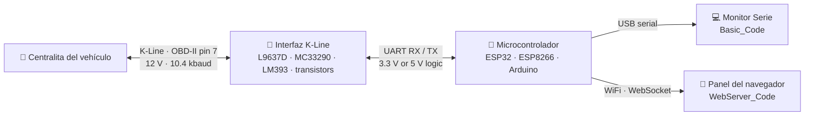

<a id="readme-top"></a>

<div align="center">

<a href="#-quick-start">
  
</a>

<h1>OBD2 K-Line Reader</h1>

<p><b>Herramienta de diagnóstico automotriz de código abierto para ESP32, ESP8266 y Arduino.</b><br>
Read live sensor data, read &amp; clear trouble codes (DTCs), freeze-frame data and VIN from any <b>K-Line</b> vehicle<br>
over <b>ISO 9141-2</b> and <b>KWP2000 (ISO 14230)</b>, desde un panel web en el navegador del teléfono.</p>

<p>
  <a href="https://github.com/muki01/OBD2_K-line_Reader/stargazers"></a>
  <a href="https://github.com/muki01/OBD2_K-line_Reader/network/members"></a>
  <a href="https://github.com/muki01/OBD2_K-line_Reader/issues"></a>
  <a href="LICENSE"></a>
  <a href="https://github.com/muki01/OBD2_K-line_Reader/commits/main"></a>
</p>

<p>
  <a href="#default-pins"></a>
  <a href="#default-pins"></a>
  <a href="#default-pins"></a>
  <a href="#default-pins"></a>
  <a href="#default-pins"></a>
  <a href="#-supported-protocols"></a>
  <a href="#-supported-protocols"></a>
  <a href="https://pcbway.com/g/SD5aQu"></a>
</p>

**[Funciones](#-features)** · **[Demostración](#-see-it-in-action)** · **[Capturas](#-web-dashboard-screenshots)** · **[Cómo funciona](#-how-it-works)** · **[Hardware](#-hardware)** · **[Inicio rápido](#-quick-start)** · **[Preguntas frecuentes](#-faq)** · **[Desarrollo a medida](#-custom-development)**

</div>

---

## 📖 Acerca del proyecto

**OBD2 K-Line Reader** es un firmware completo, listo para cargar, que convierte un microcontrolador económico en una herramienta de diagnóstico OBD-II para vehículos con bus **K-Line**. Incluye muchos automóviles europeos y asiáticos fabricados aproximadamente entre **2000 y 2010**, antes de la generalización de CAN.

Conéctalo al puerto OBD-II para consultar **datos del motor en tiempo real**, **códigos de avería** (leer y borrar), **capturas congeladas**, **VIN e identificadores de calibración de la ECU**, un **cronómetro de aceleración de 0 a 100 km/h** y la **tensión de la batería**. No necesita adaptador ELM327, software de PC ni aplicación de pago.

El proyecto incluye dos versiones:

| Versión | Uso recomendado | Resultado | Placas |
|---|---|---|---|
| 🌐 **[`WebServer_Code`](WebServer_Code/README.md)** | A standalone WiFi scan tool | Mobile-friendly web dashboard (WebSocket), OTA updates | ESP32 (incl. S3 / C3 / C6), ESP8266 |
| 🖥️ **[`Basic_Code`](Basic_Code/README.md)** | Quick tests, learning, porting | Monitor Serie | Arduino Uno / Nano / Pro Mini, ESP32 |

También incluye **seis esquemas de interfaz**, desde un circuito con dos transistores hasta transceptores automotrices específicos (L9637D, MC33290, Si9241, SN65HVDA195), para construir el hardware por pocos euros.

> [!TIP]
> Si este proyecto te ahorra una visita al taller o te ayuda a aprender cómo se comunican los coches, puedes dejar una ⭐ al original para que otros creadores lo encuentren.

## 🎬 Así funciona

<table>
<tr>
<td width="45%" align="center">

</td>
<td width="55%">

### Una herramienta de diagnóstico completa en tu bolsillo

El ESP32 crea su propia red WiFi. Conecta el teléfono, abre **`192.168.4.1`** y accede a las funciones de diagnóstico con un toque:

- 📊 **Datos en directo**: PID enviados en tiempo real mediante WebSocket.
- ⚠️ **Códigos de avería**: lee y borra DTC; incluye unas 1000 descripciones.
- ❄️ **Captura congelada**: valores de sensores guardados al registrarse la avería.
- 🏁 **Prueba de 0–100 km/h**: comienza y termina automáticamente a partir del PID de velocidad.
- 🚗 **Información del vehículo**: VIN, ID de calibración y mapas de PID admitidos.
- ⚙️ **Ajustes**: protocolo, selección de PID, WiFi y actualización OTA del firmware.
- 🌙 **Modo oscuro**, recordado en cada dispositivo.

No hace falta instalar una aplicación ni conectarse a la nube. Funciona en los navegadores de Android, iOS y ordenador.

</td>
</tr>
</table>

## ✨ Funciones

<table>
<tr>
<td valign="top" width="33%">

#### 🩺 Diagnóstico
- Datos de sensores en directo (**OBD-II Mode 01**)
- Datos congelados (**Mode 02**)
- DTC almacenados (**Mode 03**)
- Borrar DTC / reiniciar el testigo MIL (**Mode 04**)
- DTC pendientes (**Mode 07**)
- VIN e identificadores de calibración (**Mode 09**)
- Unas 1000 descripciones de DTC (P, C, B, U)
- Supervisión de la tensión de batería

</td>
<td valign="top" width="33%">

#### 📡 Protocolos
- **ISO 9141-2** (inicialización a 5 baudios)
- **ISO 14230-4 KWP2000**, inicialización lenta
- **ISO 14230-4 KWP2000**, inicialización rápida
- **Detección automática del protocolo**
- Cambio de protocolo durante el funcionamiento
- Reconexión automática si se pierde el enlace
- Temporización correcta a 10,4 kbaudios, cancelación de eco y sumas de comprobación

</td>
<td valign="top" width="33%">

#### 🛠️ Plataformas
- ESP32 / S3 / C3 / C6, ESP8266
- Arduino Uno, Nano, Pro Mini
- Adaptable a STM32 y RP2040
- WiFi en modo **punto de acceso o estación**
- **Actualizaciones OTA del firmware** (ESP32)
- Ajustes stored in SPIFFS
- Avisos de estado mediante zumbador y LED
- Seis opciones de interfaz de hardware

</td>
</tr>
</table>

## 📱 Capturas del panel web

<div align="center">
<sub>Las capturas cambian entre tema claro y oscuro según el tema de GitHub.</sub>
</div>

<table>
<tr>
<td align="center" width="25%">
<picture><source media="(prefers-color-scheme: dark)" srcset="images/screenshots/dark/main-menu.png"></picture>
<br><b>Menú principal</b><br><sub>Tensión de batería y accesos rápidos</sub>
</td>
<td align="center" width="25%">
<picture><source media="(prefers-color-scheme: dark)" srcset="images/screenshots/dark/live-data.png"></picture>
<br><b>Datos en directo</b><br><sub>PID de sensores en tiempo real</sub>
</td>
<td align="center" width="25%">
<picture><source media="(prefers-color-scheme: dark)" srcset="images/screenshots/dark/error-codes.png"></picture>
<br><b>Códigos de avería</b><br><sub>Leer y borrar DTC</sub>
</td>
<td align="center" width="25%">
<picture><source media="(prefers-color-scheme: dark)" srcset="images/screenshots/dark/freeze-frame.png"></picture>
<br><b>Captura congelada</b><br><sub>Instantánea al producirse la avería</sub>
</td>
</tr>
<tr>
<td align="center">
<picture><source media="(prefers-color-scheme: dark)" srcset="images/screenshots/dark/speed-test.png"></picture>
<br><b>Prueba de 0–100 km/h</b><br><sub>Medición automática de aceleración</sub>
</td>
<td align="center">
<picture><source media="(prefers-color-scheme: dark)" srcset="images/screenshots/dark/vehicle-info.png"></picture>
<br><b>Información del vehículo</b><br><sub>VIN, ID de calibración y PID admitidos</sub>
</td>
<td align="center">
<picture><source media="(prefers-color-scheme: dark)" srcset="images/screenshots/dark/settings.png"></picture>
<br><b>Ajustes</b><br><sub>Protocolo, PID, WiFi y OTA</sub>
</td>
<td align="center">
<picture><source media="(prefers-color-scheme: dark)" srcset="images/screenshots/dark/splash-screen.png"></picture>
<br><b>Pantalla de inicio</b><br><sub>Animación de arranque</sub>
</td>
</tr>
</table>

> [!NOTE]
> La interfaz del panel se desarrolla en su propio repositorio: **[OBD2 Diagnostic UI](https://github.com/muki01/OBD2-Diagnostic-UI)**. Se incluye una copia compilada y comprimida con gzip en [`WebServer_Code/data`](WebServer_Code/data).

## 🧭 Cómo funciona



1. **Activación.** The firmware wakes the ECU with a **5-baud init** (address `0x33`) or a **fast init** (25 ms low / 25 ms high pulse followed by `StartCommunication`: `C1 33 F1 81 66`).
2. **Detección.** In `Automatic` mode it tries ISO 9141-2, then KWP2000 slow and fast init, and remembers whichever protocol the ECU answers on.
3. **Solicitud.** Norma OBD-II service requests (Modes 01, 02, 03, 04, 07 and 09) are framed with the right header (`68 6A F1` for ISO 9141 or `Cx 33 F1` for KWP2000) plus a checksum.
4. **Decodificación.** Responses are validated, the K-Line echo is removed, and the values are converted to engineering units using the SAE J1979 formulas.
5. **Publicación.** Values go to the Monitor Serie, or to the web dashboard as JSON over a WebSocket about every 100 ms.

### 📡 Protocolos compatibles

| Protocol | Norma | Inicialización | Cabecera | Estado |
|---|---|---|---|:---:|
| ISO 9141-2 | ISO 9141-2 | 5-baud slow init | `68 6A F1` | ✅ Probado |
| KWP2000 (slow init) | ISO 14230-4 | 5-baud slow init | `Cx 33 F1` | ✅ Probado |
| KWP2000 (fast init) | ISO 14230-4 | 25 ms wake-up pattern | `Cx 33 F1` | ✅ Probado |
| Detección automática | none | Tries all of the above | none | ✅ Default |

> [!IMPORTANT]
> **Does my car use K-Line?** Look at your OBD-II socket. If **pin 7** has a metal contact, the car very likely speaks ISO 9141-2 or KWP2000. Cars that only have pins 6 and 14 use **CAN (ISO 15765-4)**; for those, see **[OBD2 CAN Bus Reader](https://github.com/muki01/OBD2_CAN_Bus_Reader)**.

## 🔧 Hardware

### Qué necesitas

| Part | Notes |
|---|---|
| Microcontrolador | ESP32 / ESP32-S3 / C3 / C6 or ESP8266 for the web dashboard; Arduino Uno / Nano / Pro Mini or ESP32 for `Basic_Code` |
| Interfaz K-Line | Any circuit from the [schematics](#-interface-schematics) below |
| OBD-II male connector | Or a cut OBD-II extension cable |
| 12 V → 5 V / 3.3 V regulator | A small buck converter to power the board from OBD-II pin 16 |
| *Optional* | Buzzer and LED for status feedback, 47 kΩ / 10 kΩ divider for battery voltage |

### Conector OBD-II (K-Line)

| OBD-II pin | Signal | Connect to |
|:---:|---|---|
| **7** | K-Line (ISO 9141-2 / ISO 14230) | K pin of the interface |
| **16** | Battery +12 V (permanent) | Interfaz VBAT + regulator input |
| **4** / **5** | Chassis / signal ground | Common GND |

### 🔌 Esquemas de interfaz

K-Line is a single-wire, 12 V, open-collector bus, so it can't be wired straight to a 3.3 V or 5 V UART. Each circuit below does the level shifting and protection. Pick one.

#### Con transistores: económico y adecuado para prototipos


Built from discrete transistors, so it costs almost nothing. **R6** is sized for **3.3 V** microcontrollers; for a **5 V** MCU, change **R6** to **5.3 kΩ**.

#### Con comparador LM393: mayor inmunidad al ruido


A cheap comparator such as the **LM393** gives a clean digital level with well-defined thresholds. It needs a few more parts than the transistor version but is noticeably more robust.

#### Transceptores automotrices específicos — L9637D, MC33290, Si9241, SN65HVDA195

<p>
  
  
</p>
<p>
  
  
</p>

Purpose-built ISO 9141 transceivers with built-in level shifting and protection. They are standards-compliant and the most reliable choice, which makes them the right pick for permanent and production designs.

### 🧩 PCB personalizadas

<p align="center">
  
  
  
</p>

<table>
  <tr>
    <td width="20%" valign="middle">
      <a href="https://pcbway.com/g/SD5aQu"></a>
    </td>
    <td width="80%" valign="middle">
      The custom PCBs in this project were manufactured with sponsorship from <a href="https://pcbway.com/g/SD5aQu"><b>PCBWay</b></a>. Board quality, fast delivery and support were excellent, and I'm grateful for their help. Need boards for your own project? <a href="https://pcbway.com/g/SD5aQu"><b>Check out PCBWay →</b></a>
    </td>
  </tr>
</table>

## 🚀 Inicio rápido

```bash
git clone https://github.com/muki01/OBD2_K-line_Reader.git
```

1. **Build the interface** using one of the [schematics](#-interface-schematics) and wire it to your board's UART.
2. **Choose a build** and follow its step-by-step guide:
   - 🌐 **[WebServer_Code: setup guide](WebServer_Code/README.md)** (ESP32 / ESP8266 web dashboard)
   - 🖥️ **[Basic_Code: setup guide](Basic_Code/README.md)** (Arduino / ESP32 Monitor Serie)
3. **Plug into the OBD-II port**, turn the ignition **on**, and wait a few seconds for the handshake.
4. **Web build:** join the WiFi network **`OBD2 Master`** (password `12345678`) and open **http://192.168.4.1**.

### Pines predeterminados

| Board | K-Line RX | K-Line TX | UART | LED | Buzzer | Battery ADC |
|---|:---:|:---:|:---:|:---:|:---:|:---:|
| ESP32 / ESP32-S3 (WebServer & Basic) | GPIO 10 | GPIO 11 | `Serial1` | GPIO 6 | GPIO 8 *(web)* | GPIO 1 *(web)* |
| ESP8266 (WebServer) | GPIO 3 | GPIO 1 | `Serial` (UART0) | GPIO 2 | GPIO 4 | GPIO 5 |
| Arduino Uno / Nano / Pro Mini (Basic) | D8 | D9 | AltSoftSerial | D13 | none | none |

> [!NOTE]
> GPIO 10 / 11 fit ESP32-S3 / C3 / C6 boards. On a classic ESP32-WROOM they are connected to the SPI flash, so pick other free pins there (for example GPIO 16 / 17) by editing the `#define`s at the top of the sketch.

## 🗂️ Estructura del repositorio

```text
OBD2_K-line_Reader/
├── WebServer_Code/        # ESP32 / ESP8266 firmware with WiFi web dashboard + OTA
│   ├── data/              # Gzipped web UI (upload to SPIFFS)
│   └── README.md          # Setup guide
├── Basic_Code/            # Monitor Serie firmware for Arduino & ESP32
│   └── README.md          # Setup guide
├── Schematics/            # Interfaz K-Line circuits (transistor, LM393, L9637D, MC33290, ...)
└── images/                # Banner, demo GIF and screenshots
```

## ❓ Preguntas frecuentes

<details>
<summary><b>¿Qué es K-Line?</b></summary>
<br>
K-Line is a single-wire, bidirectional serial bus on <b>pin 7</b> of the OBD-II connector. It runs at 10.4 kbaud with 12 V logic levels and carries two diagnostic protocols: <b>ISO 9141-2</b> and <b>ISO 14230 (KWP2000)</b>. It was the dominant diagnostic bus on European and Asian vehicles until CAN (ISO 15765-4) replaced it.
</details>

<details>
<summary><b>¿Qué coches son compatibles?</b></summary>
<br>
Any vehicle whose engine ECU answers generic OBD-II requests over ISO 9141-2 or KWP2000. In practice that is most European and Asian petrol cars from about 2000 to 2010, plus many diesels. Check that pin 7 of your OBD-II socket is populated. Manufacturer-specific protocols such as VAG KW1281 or BMW I/K-Bus are handled in <a href="#-related-projects">related projects</a>.
</details>

<details>
<summary><b>¿Sustituye a un ELM327? ¿Funciona con Torque o Car Scanner?</b></summary>
<br>
It replaces the ELM327 <i>for K-Line vehicles</i>, but it does not emulate the ELM327 AT command set, so third-party ELM327 apps won't connect to it. It comes with its own web dashboard (no app needed) and a Monitor Serie build that you can easily extend or integrate.
</details>

<details>
<summary><b>¿Qué diferencia hay entre ISO 9141-2 y KWP2000?</b></summary>
<br>
Both run on the same physical K-Line at 10.4 kbaud. ISO 9141-2 always starts with a slow 5-baud init and uses the <code>68 6A F1</code> header. KWP2000 (ISO 14230) supports both slow and <b>fast init</b>, uses length-encoded headers (<code>Cx 33 F1</code>) and adds richer services. Leave the firmware on <code>Automatic</code> and it figures this out for you.
</details>

<details>
<summary><b>¿Puedo apagar el testigo de avería del motor (MIL)?</b></summary>
<br>
Yes. <b>Clear Error Codes</b> sends OBD-II Mode 04, which clears stored DTCs, freeze-frame data and the MIL. Fix the underlying fault first, or the code will come back.
</details>

<details>
<summary><b>¿Puedo usarlo con un coche con bus CAN?</b></summary>
<br>
Not with this firmware. Use the sister project <a href="https://github.com/muki01/OBD2_CAN_Bus_Reader"><b>OBD2 CAN Bus Reader</b></a>, which shares the same web dashboard.
</details>

## 🤝 Contribuciones

Contributions are welcome: bug reports, new PIDs, tested vehicle reports, new board ports and documentation fixes. Please read the **[Contribuciones Guide](CONTRIBUTING.md)** and our **[Code of Conduct](CODE_OF_CONDUCT.md)**.

**Probado it on your car?** Open an issue with the make, model, year and detected protocol. Real-world compatibility reports help everyone.

## 🔗 Proyectos relacionados

This firmware is part of a family of open-source automotive projects. They share the same hardware approach, so what you build for one carries over to the others.

<table>
  <tr>
    <th colspan="3" align="left">Firmware: cárgalo y úsalo</th>
  </tr>
  <tr>
    <td width="30%"><a href="https://github.com/muki01/BMW_IBus_KBus"><b>BMW I-Bus / K-Bus Firmware</b></a></td>
    <td>Phone control and key-fob light functions for the BMW E46, on the ESP32 and Arduino.</td>
    <td width="118" align="center"><a href="https://github.com/muki01/BMW_IBus_KBus/stargazers"></a></td>
  </tr>
  <tr>
    <td width="30%"><b>OBD2 K-Line Reader</b><br><sub>you are here</sub></td>
    <td>Scan tool for K-Line cars (ISO 9141-2, KWP2000) with a web dashboard, for the ESP32, ESP8266 and Arduino.</td>
    <td width="118" align="center"><a href="https://github.com/muki01/OBD2_K-line_Reader/stargazers"></a></td>
  </tr>
  <tr>
    <td width="30%"><a href="https://github.com/muki01/OBD2_CAN_Bus_Reader"><b>OBD2 CAN Bus Reader</b></a></td>
    <td>Scan tool for CAN bus cars (ISO 15765-4) with the same web dashboard, for the ESP32.</td>
    <td width="118" align="center"><a href="https://github.com/muki01/OBD2_CAN_Bus_Reader/stargazers"></a></td>
  </tr>
  <tr>
    <td width="30%"><a href="https://github.com/muki01/VAG_KW1281"><b>VAG KW1281</b></a></td>
    <td>KW1281 diagnostics for VW, Audi, Škoda and SEAT: ECU information, measuring groups and fault codes.</td>
    <td width="118" align="center"><a href="https://github.com/muki01/VAG_KW1281/stargazers"></a></td>
  </tr>
  <tr>
    <th colspan="3" align="left">Bibliotecas: crea tu propio firmware</th>
  </tr>
  <tr>
    <td width="30%"><a href="https://github.com/muki01/BMW_IBus_KBus_Library"><b>BMW IBus KBus Library</b></a></td>
    <td>Receives, checks and sends BMW I-Bus and K-Bus messages; the library behind the BMW firmware.</td>
    <td width="118" align="center"><a href="https://github.com/muki01/BMW_IBus_KBus_Library/stargazers"></a></td>
  </tr>
  <tr>
    <td width="30%"><a href="https://github.com/muki01/OBD2_KLine_Library"><b>OBD2 K-Line Library</b></a></td>
    <td>K-Line diagnostics behind one API: ISO 9141-2, KWP2000, KW1281, DS2 and KW82.</td>
    <td width="118" align="center"><a href="https://github.com/muki01/OBD2_KLine_Library/stargazers"></a></td>
  </tr>
  <tr>
    <td width="30%"><a href="https://github.com/muki01/OBD2_CAN_Bus_Library"><b>OBD2 CAN Bus Library</b></a></td>
    <td>OBD-II diagnostics over ISO 15765-4 with the ESP32's built-in CAN controller.</td>
    <td width="118" align="center"><a href="https://github.com/muki01/OBD2_CAN_Bus_Library/stargazers"></a></td>
  </tr>
  <tr>
    <th colspan="3" align="left">Interfaz</th>
  </tr>
  <tr>
    <td width="30%"><a href="https://github.com/muki01/OBD2-Diagnostic-UI"><b>OBD2 Diagnostic UI</b></a></td>
    <td>The web dashboard used by the two OBD2 readers.</td>
    <td width="118" align="center"><a href="https://github.com/muki01/OBD2-Diagnostic-UI/stargazers"></a></td>
  </tr>
</table>

> 💡 **¿Vas a crear tu propio firmware?** The **[OBD2 K-Line Library](https://github.com/muki01/OBD2_KLine_Library)** wraps the K-Line protocol in a clean Arduino API.

## 💼 Desarrollo a medida

I design automotive diagnostic tools, firmware and hardware professionally. Whether you need a complete product or only the communication layer, I can help.

| Service | Details |
| :-- | :-- |
| **Protocol implementation** | BMW I/K-Bus, K-Line (ISO 9141-2 / KWP2000), CAN / UDS, VAG KW1281 and other manufacturer-specific protocols |
| **ECU communication & reverse engineering** | Bus sniffing, packet decoding, module control, undocumented ECUs and buses |
| **ECU security access** | Seed-key algorithms and unlock routines for KWP2000 / UDS |
| **Embedded firmware** | Arduino, ESP32, ESP8266, STM32, Raspberry Pi Pico |
| **Custom hardware** | Diagnostic dongles, shields and PCBs designed to your requirements |
| **Companion apps** | Android, iOS and web apps to visualise, log and control your device |

Have a project in mind? Reach out through the [Contacto](#-contact) section below.

## 📬 Contacto

For custom development, collaboration, sponsorship or ready-made devices:

| Canal | Dirección |
| :-- | :-- |
| 📧 **Email** | [muksin.muksin04@gmail.com](mailto:muksin.muksin04@gmail.com) |
| 💼 **LinkedIn** | [linkedin.com/in/muksin-muksin](https://www.linkedin.com/in/muksin-muksin/) |
| 🐙 **GitHub** | [@muki01](https://github.com/muki01) |

## ☕ Apoya el proyecto

Si este proyecto te ha sido útil, puedes apoyar su desarrollo:

<p>
  <a href="https://www.buymeacoffee.com/muki01"></a>
  <a href="https://www.paypal.com/donate/?hosted_button_id=SAAH5GHAH6T72"></a>
  <a href="https://github.com/sponsors/muki01"></a>
</p>

## 📈 Historial de estrellas

<a href="https://star-history.com/#muki01/OBD2_K-line_Reader&Date">
  <picture>
    <source media="(prefers-color-scheme: dark)" srcset="https://api.star-history.com/svg?repos=muki01/OBD2_K-line_Reader&type=Date&theme=dark">
    
  </picture>
</a>

## ⚠️ Aviso

> [!WARNING]
> This is a hobby and educational project provided **as is**, without warranty. Connecting custom hardware to a vehicle carries risk. The author is not responsible for any damage to vehicles, ECUs or equipment. **Never operate the device or look at the dashboard while driving.** Run the acceleration test only on closed roads or private property, in line with local law.

## 📄 Licencia

Released under the **[GNU General Public Licencia v3.0](LICENSE)**.

- You are free to use, study, modify and share this firmware.
- If you distribute it — on its own or as part of a product or firmware — you must make the complete source available under the same license.

**Closed-source or commercial product?** A separate commercial license is available. Get in touch through the [Contacto](#-contact) section.

Copyright © 2023–2026 Muksin Muksin.

---

<div align="center">

Creado por [**Muki**](https://github.com/muki01) · If this project helped you, please give it a ⭐

<sub>OBD2 · OBD-II · K-Line · KWP2000 · ISO 9141-2 · ISO 14230 · ESP32 · ESP8266 · Arduino · diagnóstico de coches · lector DTC</sub>

**[⬆ Volver arriba](#readme-top)**

</div>
